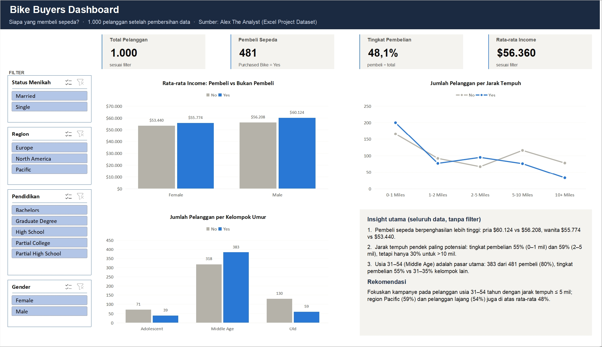

# Bike Buyers Dashboard di Excel

Dashboard interaktif yang menjawab pertanyaan **"siapa yang membeli sepeda?"** dari data 1.000 pelanggan.
Prosesnya lengkap di satu file Excel: data mentah dibersihkan, diringkas dengan PivotTable, lalu disajikan sebagai dashboard dengan slicer (dataset dari [Alex The Analyst](https://github.com/AlexTheAnalyst/Excel-Tutorial)).

**Tools:** Microsoft Excel

**Teknik:** Remove Duplicates · Find & Replace · kolom bantu dengan `IF` bertingkat · PivotTable · PivotChart · Slicer yang terhubung ke semua chart · kartu KPI



---

## Alur kerja
| Sheet | Isi |
|---|---|
| `bike_buyers` | Data mentah (1.026 baris), tidak diubah |
| `Working Sheet` | Salinan yang dibersihkan: 26 baris duplikat dihapus (→ **1.000 baris**), kode `M`/`F` → Male/Female dan `M`/`S` → Married/Single, kolom baru **Age Bracket** |
| `Pivot Table` | 4 PivotTable: KPI, income per gender, jarak tempuh, kelompok umur |
| `Dashboard` | 4 kartu KPI, 3 chart, 4 slicer (status menikah, region, pendidikan, gender), dan kotak insight |

Rumus kolom Age Bracket:
```
=IF(L2>54,"Old",IF(L2>=31,"Middle Age","Adolescent"))
```

## Temuan utama
1. **Usia 31–54 (Middle Age) adalah pasar utama.** Kelompok ini berisi 383 dari 481 pembeli (80%), dengan tingkat pembelian 55%. Dua kelompok umur lainnya hanya 31–35%.
2. **Jarak tempuh pendek paling potensial.** Tingkat pembelian 55% untuk 0–1 mil dan 59% untuk 2–5 mil, tetapi hanya 30% untuk lebih dari 10 mil.
3. **Pembeli rata-rata berpenghasilan sedikit lebih tinggi:** pria $60.124 vs $56.208, wanita $55.774 vs $53.440.

**Rekomendasi:** fokuskan kampanye pada pelanggan usia 31–54 tahun yang jarak tempuhnya ≤ 5 mil.

## Catatan statistik (ditambahkan setelah belajar statistik)
Saya menguji ulang temuan di atas dengan Python (`scipy`):
- Selisih income pembeli dan bukan pembeli (sekitar $3.000) **tidak signifikan** secara statistik (uji t Welch, p = 0,12). Selisih itu bisa saja hanya kebetulan, jadi income **bukan** dasar yang kuat untuk menentukan target kampanye.
- Jarak tempuh (uji chi-square, p < 0,001) dan status pernikahan (p < 0,001) **terbukti berhubungan** dengan keputusan membeli. Gender **tidak** (p = 0,68).

## Versi lain dari proyek ini
- Power BI: [powerbi-bike-buyers](https://github.com/Dewi1717/powerbi-bike-buyers). Angkanya sama persis dengan versi Excel ini.

## Cara membuka
Unduh `Proyek1-Bike-Buyers.xlsx`, buka dengan Excel 2016 atau yang lebih baru, lalu klik tombol slicer di sheet `Dashboard`.
Data asli Alex ada di folder `sumber/`.
